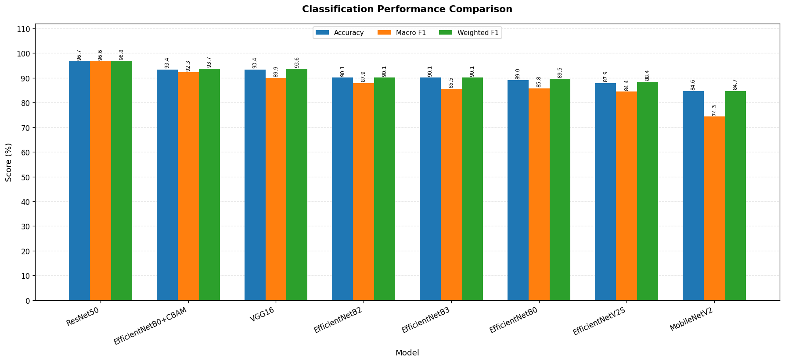
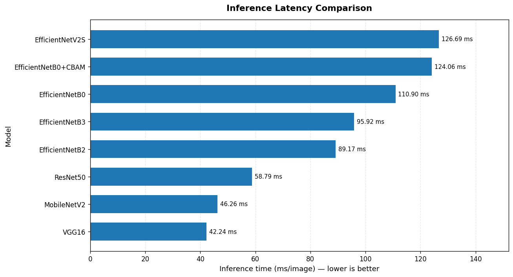
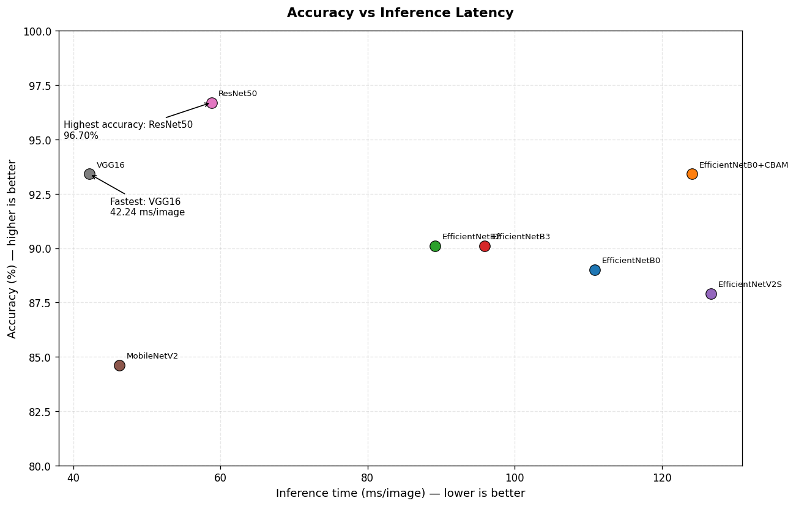

# Brain Tumor Classification on 2D MRI Images

**A comparative deep learning study of eight CNN architectures for four-class brain MRI image classification.**

## Overview

This project investigates the performance of transfer learning-based Convolutional Neural Networks (CNNs) for classifying 2D brain Magnetic Resonance Imaging (MRI) images into four categories: **glioma, meningioma, pituitary tumor and no tumor**.

The primary objective is to conduct a comparative experiment across multiple CNN architectures under a consistent evaluation pipeline. The study examines classification performance, class-wise behavior, inference latency, and the potential contribution of an attention mechanism.

Eight model configurations are evaluated, including conventional CNN architectures, lightweight networks, EfficientNet variants, and an EfficientNetB0 model enhanced with Convolutional Block Attention Module (CBAM).

This repository contains the experimental notebook, evaluation workflow, and supporting project documentation.

> **Disclaimer:** This project is intended for educational and research purposes only. It is not a clinically validated diagnostic system and must not be used to make medical decisions.

## Objectives

- Assess potential data leakage through image-level duplicate detection and filtering, while examining limitations in publicly available medical-image datasets.
- Compare eight pretrained CNN architectures for four-class brain MRI image classification.
- Investigate the trade-off between predictive performance and inference latency.
- Evaluate models using many metrics such as Accuracy, Macro F1-score, Weighted F1-score, and False Negative Rate (FNR).
- Examine whether integrating CBAM into EfficientNetB0 improves classification performance.
- Practice reproducible experimentation, model evaluation, and result visualization using TensorFlow/Keras.

## Models Evaluated

| Model | Description |
|---|---|
| VGG16 | A classical deep CNN used as a baseline architecture. |
| MobileNetV2 | A lightweight CNN designed for computational efficiency. |
| ResNet50 | A residual network that uses skip connections to facilitate deep feature learning. |
| EfficientNetB0 | A computationally efficient CNN baseline. |
| EfficientNetB2 | A scaled EfficientNet variant with a larger model capacity than B0. |
| EfficientNetB3 | A larger EfficientNet variant for comparison across model scales. |
| EfficientNetV2S | An EfficientNetV2 architecture included to compare a newer model family. |
| EfficientNetB0 + CBAM | EfficientNetB0 enhanced with channel and spatial attention. |

### EfficientNetB0 + CBAM

The CBAM-enhanced model applies two attention mechanisms to the feature maps extracted by EfficientNetB0:

1. **Channel Attention:** Learns to emphasize informative feature channels.
2. **Spatial Attention:** Learns to emphasize informative spatial regions.

The resulting features are passed to the classification head.

The purpose of this experiment is to investigate whether attention improves classification performance in this dataset setting. The addition of attention is treated as an experimental hypothesis rather than an assumed improvement.

## Dataset

The project uses publicly available 2D brain MRI image datasets.

### Data sources

- **Training dataset:** [Brain Tumor MRI Dataset — Mendeley Data](https://data.mendeley.com/datasets/zwr4ntf94j/4)
- **Additional test dataset:** [Brain Tumour MRI Scan — Hugging Face Datasets](https://huggingface.co/datasets/Simezu/brain-tumour-MRI-scan)

### Classification labels

The four target classes are:

| Label | Description |
|---|---|
| `glioma` | MRI images labeled as glioma. |
| `meningioma` | MRI images labeled as meningioma. |
| `pituitary` | MRI images labeled as pituitary tumor. |
| `notumor` | MRI images labeled as no tumor. |

The class-to-index mapping must remain consistent across training, validation, testing, and evaluation.

### Data preparation

The notebook implements the data preparation required by the selected models:

- Image dimensions and input tensor shape: Input_shape = (224,224,3); IMAGE_SIZE = 224
- Image loading and pixel-value preprocessing.
- Class-label encoding and class distribution.
- Training, validation, and test split strategy.
- Duplicate-image detection and any exclusion criteria.
- Whether the external test data is independent of the training data.

The datasets are **not included in this repository**. Users must obtain them from their respective sources and follow the applicable dataset licenses and terms of use.

### Data Leakage Assessment and Duplicate Filtering

An initial data quality assessment identified potential data leakage risks, including duplicate or highly similar images across training and testing splits within a dataset and across different datasets.

Given the limited availability of a suitable independent test set for this experiment, we investigated whether images from the publicly available [Simezu Brain Tumour MRI Scan dataset](https://huggingface.co/datasets/Simezu/brain-tumour-MRI-scan) could be used for additional evaluation.

We applied a multi-stage similarity-based filtering procedure using MD5 hashes, perceptual hashing (pHash), and image embedding distances to identify and exclude images suspected of overlapping with the existing data. After filtering, 91 images were retained and used as the evaluation set in this experiment.

**Limitations:** This procedure reduces the risk of image-level duplication but does not guarantee complete data independence. Similarity-based filtering depends on the selected representations, distance thresholds, and exclusion criteria. Furthermore, without patient-level identifiers, patient-level independence cannot be verified. Therefore, results obtained on this 91-image set should be interpreted as exploratory rather than definitive evidence of generalization to independent patients or clinical settings.

## Methodology

The experimental workflow is organized into the following stages:

1. **Data preparation:** Load MRI images and their corresponding labels.
2. **Data quality checks:** Inspect the data and investigate possible duplicate or near-duplicate images.
3. **Model construction:** Initialize the selected CNN architectures with pretrained weights where configured.
4. **Transfer learning:** Train the classification head and apply the fine-tuning strategy defined in the experiment notebook.
5. **Training control:** Use callbacks such as model checkpointing, learning-rate reduction, early stopping, and TensorBoard logging where configured.
6. **Evaluation:** Generate predictions on the designated test set and calculate classification metrics.
7. **Performance comparison:** Compare predictive metrics and inference latency across the eight models.
8. **Visualization:** Plot training history, classification metrics, and model performance trade-offs.

Refer to `experiment.ipynb` for the implementation details and the actual experimental configuration.

## Evaluation Metrics

### Accuracy

The proportion of correctly classified images among all evaluated images.

### Macro F1-score

The unweighted average of the F1-score across the four classes. It gives each class equal importance, regardless of its sample count.

### Weighted F1-score

The average F1-score weighted by the number of true samples in each class.

### Inference latency

The average time required to produce a prediction for one image, reported in milliseconds per image (ms/image).

Inference latency depends on hardware, batch size, input resolution, preprocessing, warm-up, and timing methodology. Comparisons are meaningful only when these conditions are controlled and documented.

### False Negative Rate (FNR)

In this project, FNR is intended to measure the proportion of actual tumor images incorrectly classified as `notumor`:

\[
\mathrm{FNR} =
\frac{\text{Tumor images predicted as no tumor}}
{\text{All actual tumor images}}
\times 100\%
\]

This definition is specific to the project's evaluation setup. It should not be confused with the false negative rate for a particular tumor subtype or with a clinically validated screening sensitivity.

## Experimental Results

The following table summarizes the current recorded results. Values are reproduced from the experiment results supplied for this repository.

| Model | Accuracy (%) | Macro F1 (%) | Weighted F1 (%) | Inference (ms/image) | FNR (%) |
|---|---:|---:|---:|---:|---:|
| EfficientNetB0 | 89.01 | 85.80 | 89.53 | 110.8993 | 0 |
| EfficientNetB0 + CBAM | 93.41 | 92.27 | 93.73 | 124.0632 | 0 |
| EfficientNetB2 | 90.11 | 87.91 | 90.12 | 89.1733 | 0 |
| EfficientNetB3 | 90.11 | 85.45 | 90.13 | 95.9178 | 0 |
| EfficientNetV2S | 87.91 | 84.40 | 88.42 | 126.6859 | 0 |
| MobileNetV2 | 84.62 | 74.35 | 84.71 | 46.2649 | 0 |
| ResNet50 | 96.70 | 96.62 | 96.82 | 58.7876 | 0 |
| VGG16 | 93.41 | 89.92 | 93.61 | 42.2370 | 0 |

**Important:** The table records the observed results; it does not by itself establish that the models will generalize to independent patients or other clinical settings.

### Key observations

- **ResNet50** achieves the highest recorded Accuracy, Macro F1-score, and Weighted F1-score in this experiment.
- **VGG16** has the lowest recorded inference latency, making it an interesting candidate when prediction speed is an important constraint.
- **MobileNetV2** is also relatively fast, but its recorded Macro F1-score is lower than those of the other models.
- **EfficientNetB0 + CBAM** improves upon the recorded EfficientNetB0 baseline in Accuracy and F1-scores, while requiring more inference time.
- **EfficientNetB2, EfficientNetB3, and EfficientNetV2S** illustrate that increasing architectural complexity does not automatically improve performance on a particular dataset.

All models report an FNR of 0% in the current table. This result requires additional context, including the number of actual tumor images in the test set and the confusion matrix. It should not be interpreted as proof that the models cannot miss tumors.

## Visualizations







## Repository Structure

Brain_Tumor_Classification/
├── notebook/
│   └── experiment.ipynb
├── demo/
│   ├── demo_source.ipynb
│   └── demo_ui.png
├── assets/
│   ├── confusion_matrices/
│   ├── training_curves/
│   └── data/
├── results/
│   ├── models_comparison.png
│   ├── inference_latency_comparison.png
│   └── accuracy_inference_latency.png
├── requirements.txt
├── .gitignore
├── LICENSE
└── README.md

## Getting Started

### 1. Clone the repository

```bash
git clone https://github.com/KyDieu05/Brain_Tumor_Classification
cd Brain_Tumor_Classification
```

### 2. Use Google Colab

The notebook was developed for a Google Colab workflow, using GPU T4.

1. Open `notebook/experiment.ipynb` from the repository in Google Colab.
2. Select an appropriate runtime. A GPU runtime may reduce training time, depending on availability and model configuration.
3. Obtain the datasets from their original sources.
4. Configure the dataset paths and any Google Drive mounting cells required by the notebook.
5. Run the notebook cells in order.

### 3. Install dependencies when needed

If running in a compatible Python environment outside Colab, create a virtual environment and install the listed dependencies:

```bash
python -m venv .venv
```

Activate it, then run:

```bash
python -m pip install --upgrade pip
pip install -r requirements.txt
```

The dependency versions in `requirements.txt` reflect the recorded Colab environment where specified. They have not necessarily been verified in a clean local environment. TensorFlow compatibility depends on the Python version, operating system, and available hardware.

### 4. Configure the dataset paths

Update the notebook's data-loading cells to point to the directories containing the downloaded datasets. Do not assume that the original Google Drive paths are available on another machine.

### 5. Run the experiment

Execute the notebook from top to bottom, ensuring that preprocessing, label mapping, model training, and evaluation are consistent. Training all eight architectures may require substantial compute time.

## Limitations

This project has several important limitations:

- **Two-dimensional images:** The models classify individual 2D MRI images rather than analyzing complete 3D scans or patient histories.
- **Dataset dependence:** Performance on public datasets may not generalize to other scanners, institutions, patient populations, or clinical workflows.
- **Potential data overlap:** The absence of patient-level identifiers can prevent verification of patient independence across data splits.
- **Test-set uncertainty:** Results can be sensitive to test-set size, class distribution, duplicate removal, and split methodology.
- **Inference benchmarking:** Latency measurements may vary with hardware, runtime, batch size, and preprocessing.
- **No clinical validation:** The reported metrics are experimental results and do not establish diagnostic reliability or clinical safety.

These limitations should be considered when interpreting the results or comparing them with published studies.

## Future Work

Potential directions for further development include:

- Verify dataset overlap and improve patient-level or source-level separation where possible.
- Evaluate models over repeated random seeds or multiple independent test sets.
- Report per-class precision, recall, F1-score, and confusion matrices.
- Include confidence intervals and statistical comparisons where appropriate.
- Compare model size, parameter count, memory usage, and inference latency under a standardized benchmark.
- Investigate calibration and uncertainty estimation.
- Explore explainability methods such as Grad-CAM, while recognizing that visual explanations do not establish clinical validity.
- Evaluate on independently collected data before considering any clinical application.

## References and Data Sources

The following resources were consulted for background information on brain tumors, deep learning architectures, MRI-based brain tumor classification, and dataset preparation.

### 1. Medical Background and Brain Tumor Classification

1. **Tam Anh Hospital.** Brain tumors: overview and medical background. [Website](https://tamanhhospital.vn/benh/u-nao/)
2. **Ostrom, Q. T., et al. (2023).** *Primary brain and other central nervous system tumors diagnosed in the United States in 2016–2020.* Neuro-Oncology. [PubMed](https://pubmed.ncbi.nlm.nih.gov/37793125/)
3. **Bhattacharjee, S., et al. (2022).** *Texture, Morphology, and Statistical Analysis to Differentiate Primary Brain Tumors on Two-Dimensional Magnetic Resonance Imaging Scans Using Artificial Intelligence Techniques.* Healthcare Informatics Research, 28(1), 46–57. [PubMed](https://pubmed.ncbi.nlm.nih.gov/35172090/)
4. **Wong, Y., et al. (2025).** *Brain tumor classification using MRI images and deep learning techniques.* PLOS ONE, 20(5), e0322624. [PubMed](https://pubmed.ncbi.nlm.nih.gov/40344143/)
5. **Khan, H. A., et al. (2020).** *Brain tumor classification in MRI image using convolutional neural network.* Mathematical Biosciences and Engineering, 17(5), 6203–6216. [PubMed](https://pubmed.ncbi.nlm.nih.gov/33120595/)

### 2. Deep Learning Architectures

6. **VGG16 Architecture.** GeeksforGeeks. [Article](https://www.geeksforgeeks.org/computervision/vgg-16-cnn-model/)
7. **EfficientNet Architecture.** Roboflow. [Article](https://blog.roboflow.com/what-is-efficientnet/)
8. **MobileNetV2 Architecture.** ResearchGate. [Figure](https://www.researchgate.net/figure/Architecture-of-MobileNetV2_fig3_373163355)
9. **ResNet50 Architecture.** ResearchGate. [Figure](https://www.researchgate.net/figure/a-Architecture-of-the-ResNet50-model-b-Residual-block-3-layer-bottleneck-block-the_fig10_359733554)
10. **A Transfer Learning Based Active Learning Framework for Brain Tumor Classification** [arXiv:2011.09265](https://arxiv.org/abs/2011.09265)
11. **A Deep Learning Approach for Brain Tumor Classification and Segmentation Using a Multiscale Convolutional Neural Network** [arXiv:2402.05975](https://arxiv.org/abs/2402.05975)

### 3. Datasets

12. **Training Dataset — Brain Tumor MRI.** Mendeley Data. [Dataset](https://data.mendeley.com/datasets/zwr4ntf94j/4)
13. **Test Dataset — Brain Tumor MRI Scan.** Hugging Face, Simezu. [Dataset](https://huggingface.co/datasets/Simezu/brain-tumour-MRI-scan)

### Notes

- These resources provide background information, related research, architectural descriptions, and dataset sources relevant to this project.
- Dataset versions, image counts, class distributions, and split details should reflect the exact data used in the experiments.
- Image-level duplicate filtering does not guarantee patient-level independence. The available data may not provide sufficient information to verify whether images come from distinct patients.
- This project is intended for educational and research purposes. Its results should not be interpreted as evidence of clinical effectiveness or used as a substitute for professional medical diagnosis.
- Review the dataset terms, pretrained-weight licenses, and licenses of third-party components before redistributing data or model artifacts.

## License

The source code in this repository is distributed under the MIT License. See [`LICENSE`](LICENSE) for details.

The MIT License applies to the project code covered by the license; it does not automatically grant rights to third-party datasets, pretrained weights, or other external materials.

## Acknowledgements

This project was developed as an academic experiment in deep learning, computer vision, and medical-image classification.

Feedback, issue reports, and suggestions for improving the experimental methodology are welcome.
